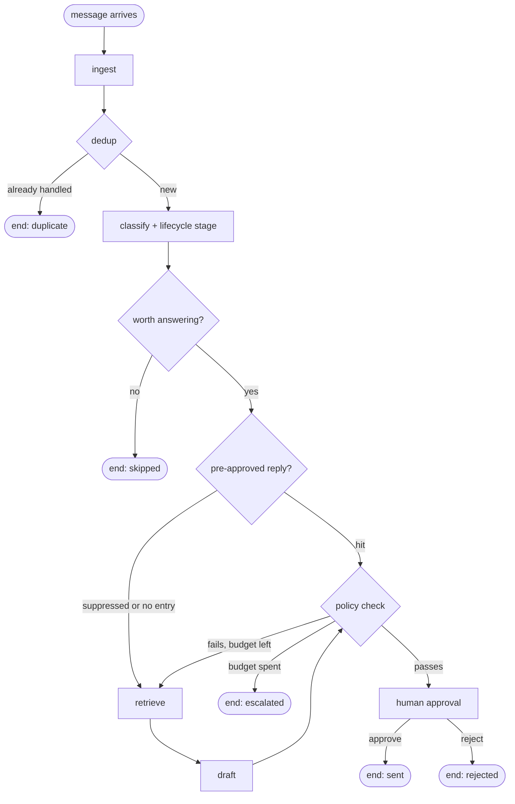

# support-agent

A customer support triage agent built as an explicit LangGraph state graph.

Most "AI support agent" demos are a prompt with a retry. The hard part in
production is not generating text, it is everything around the generation:
deciding a message is not worth answering, catching the reply that invented a
refund amount, keeping a suppressed fast path from silently dropping a customer,
and stopping at a human before anything is actually sent.

This repo is those decisions, wired as a graph, with a test for each one.

```bash
python demo.py     # nine scenarios, no API key needed
pytest             # 85 tests
python scripts/mutation_check.py   # proves the tests actually fail when the logic breaks
```

## The graph



Three things make this a graph rather than a chain:

**Two gates that end the run before any model call.** Deduplication is a hash
lookup, and triage is a rule over the contact record. Both run before
classification, so a repeated message or a one-word greeting from someone who
has never paid costs nothing. Silence is a recorded outcome with a reason
attached, not an accident.

**A fallback edge out of the fast path.** Pre-approved canned replies can be
suppressed for a given contact. When that happens the request falls through to
the model instead of returning nothing. This is the edge that exists because the
opposite behaviour, a blocked fast path returning early, is a bug that leaves
customers unanswered while the logs look clean.

**A bounded rewrite loop.** The policy checker is deterministic code, not
another model. If a draft breaks a rule, the specific violations are fed back
into the next draft. The budget comes from the contact's lifecycle stage, so a
paying customer is worth two attempts and a stranger is worth one. When the
budget runs out the run escalates and a human never sees a proposal that was
still broken.

## Lifecycle stages

Stage is computed before generation and decides how much effort the message is
worth. Priority order is deliberate:

| Priority | Stage | Condition |
|---|---|---|
| 1 | `advocate` | high lifetime value on a live plan |
| 2 | `dormant` | silent past the threshold, currently 72h |
| 3 | `customer` | paid or enterprise plan, not expired |
| 4 | `intent` | buying signal |
| 5 | `active` | engaged past a message-count floor |
| 6 | `new` | default |

Dormancy outranks buying signals on purpose. Someone reappearing after nine days
is a re-engagement, not a hot lead, and treating it as a hot lead is how these
systems start sounding like robots. Transitions are also bounded: a paying
customer cannot be dragged back into onboarding by one bad signal read.

## Policy checks are code, not a model

An LLM asked to police another LLM gives a different answer on Tuesday.
Rules that decide whether text reaches a customer need to be reproducible and
auditable, so they are regexes with a test each:

- commitments nobody is authorised to make (`guarantee`, `we promise`, `refunded today`)
- numbers that do not appear in the retrieved context, which is the expensive
  failure mode: an agent quoting a refund amount it never looked up
- legal or medical framing
- personally identifying data echoed back into the channel
- length

Grounding, not digit-banning: `$250` passes if `$250` is in the retrieved
context and fails if it is not. The comparison is on whole extracted
quantities, never substrings, because a substring test quietly grounds `$25`
against a context that only ever mentioned `$250`.

## Untrusted input

The prompt format uses bracketed field markers. A customer who writes
`[/MESSAGE]` into their message can close a field early and open a fake one,
which is how attacker text ends up being read as an instruction from you. Every
untrusted string is passed through `neutralise()` before interpolation:
the customer message, the conversation history, and retrieved passages, since
retrieval corpora are frequently built from user-submitted content.

Ordinary brackets survive, so `[Errno 2]` in a bug report still reads correctly.

## Human in the loop

The approval node calls LangGraph's `interrupt`, which checkpoints the entire
graph. The process can die at that point and a different worker can resume it
hours later with the reviewer's decision. Approve, approve with an edit, or
reject. Anything the router does not recognise as an approval fails closed.

```
  . ingest: 50 chars
  . dedup: miss
  . classify: intent=billing stage=customer (plan=paid, active)
  . triage: proceed
  . canned: no entry, falling through to model
  . retrieve: 2 passages
  . draft: 58 chars
  . policy: 3 issue(s) - makes a commitment the agent cannot authorise; states
            '$250', which is not in the retrieved context; states '3 business
            days', which is not in the retrieved context
  . retrieve: 2 passages
  . redraft #1: 78 chars
  . policy: pass
  . approval: approve
  . send: dispatched
```

Every node appends to a `trace` list that accumulates rather than overwrites, so
a finished run explains itself without turning on a tracing backend.

## Testing

The default provider is a deterministic stub, so every branch is reachable with
no network and no API key. `ScriptedStub` plays back fixed completions for the
paths a rule-based stub will never produce on its own: a draft that breaks
policy, a malformed classification, a model that keeps making the same mistake
until the budget runs out.

A green suite proves nothing until you have watched it go red for the right
reason, so `scripts/mutation_check.py` breaks one safety property at a time and
checks that the specific test named as its guard is the one that fails:

```
KILLED    fallback edge removed: suppressed canned reply dead-ends
KILLED    approval fails open: unknown decision is treated as approval
KILLED    rewrite loop unbounded: budget check removed
KILLED    dormancy no longer outranks buying signals
KILLED    grounding back to a substring test: '$25' passes against '$250'
KILLED    prompt field markers no longer stripped from untrusted text

all 6 mutations killed
```

The last two mutations exist because those were real bugs, found in a security
pass over this repo before it was published and written up in
[`codescan-findings.md`](codescan-findings.md). Both were sitting in the
features this README is loudest about, which is the usual place for them.

## Swapping in real components

Three seams, one method each:

```python
Deps(
    provider=AnthropicProvider(),   # or any object with .complete()
    knowledge=KnowledgeBase(),      # .search(intent, query) -> list[str]
    dedup=DedupStore(),             # .seen(key) / .remember(key)
)
```

`build_graph(deps, checkpointer=...)` takes any LangGraph checkpointer.
In-memory for tests, Postgres in production, nothing else changes.

```bash
pip install -e ".[anthropic,dev]"
export ANTHROPIC_API_KEY=...
export SUPPORT_AGENT_PROVIDER=anthropic
```

## What this is not

It is a control-flow reference implementation, not a product. Retrieval is a
dict lookup, the canned library is in memory, and `send` is a no-op that marks
the outcome. Those are the three places you would replace first. The parts worth
copying are the graph shape, the policy layer, and the way the tests are proven
to fail.

Requires Python 3.11+. Built against langgraph 1.2.
